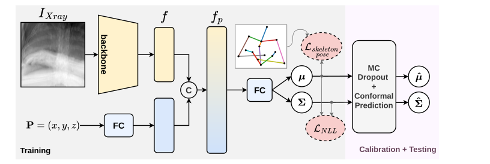
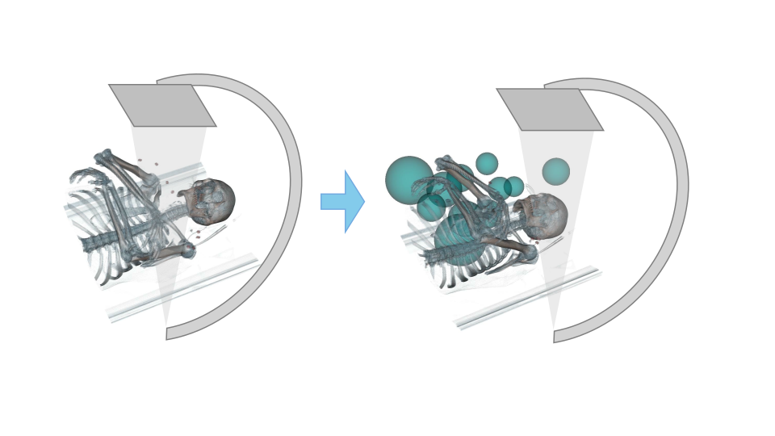

# Automated C-Arm Positioning via Conformal Landmark Localization

[](https://www.python.org/)
[](https://pytorch.org/)
[](LICENSE)

This repository contains the official implementation of the paper **[Automated C-Arm Positioning via Conformal Landmark Localization](https://openaccess.thecvf.com/content/ICCV2025W/APAH/html/Arrabi_Automated_C-Arm_Positioning_via_Conformal_Landmark_Localization_ICCVW_2025_paper.html)**, accepted at the **[ICCV Workshop on Advanced Perception for Autonomous Healthcare (APAH), 2025](https://apahws.github.io/)**.

## Introduction

Our method automates translational C-arm positioning by regressing the displacement vectors from the current view to anatomical landmarks. We use conformal prediction to provide valid confidence intervals for the model's predictions, ensuring safety and reliability in clinical settings.

### Model Overview
<p align="center">
  
</p>

<p align="center">
  
</p>

---

## Installation

1.  **Clone the repository:**
    ```bash
    git clone https://github.com/yourusername/C_arm_guidance_APAH.git
    cd C_arm_guidance_APAH
    ```

2.  **Install dependencies:**
    It is recommended to use a virtual environment.
    ```bash
    pip install -r requirements.txt
    ```

---

## Dataset Preparation

**Note:** The `data/` directory included in this repository contains a **sample dataset** (3 patients for training, calibration, and testing) for illustration purposes only. It allows you to run the code so then you can adapt it to your dataset.

To use your own dataset, organize it as follows:

```
data/
├── gaussian_xyz_dataset.csv  # Contains paths to DRRs and ground truth (x, y, z)
├── landmark_dataset.csv      # Contains anatomical landmark distributions
├── ct_size.csv               # Contains physical dimensions of the CT volumes
└── DRRs/                     # Directory containing your X-ray images
```

---

## Usage

The pipeline consists of three main steps: **Training**, **Calibration**, and **Testing**.

### 1. Training
Train the landmark regression model. This script trains a neural network to predict the vector from the current C-arm viewpoint to the target landmarks.

```bash
python src/train_landmark_regression.py \
  --exp_name my_experiment \
  --model_name resnet34 \
  --is_probabilistic \
  --positional_encoding \
  --skeleton_distance_loss \
  --augmentation_strength strong
```

### 2. Calibration
After training, calculate the nonconformity scores to generate conformal prediction intervals. This step uses a separate calibration set to ensure statistical validity.

```bash
python src/calibration_interval_generator.py \
  --exp_name my_experiment \
  --model_name resnet34 \
  --is_probabilistic \
  --positional_encoding
```
*Note: Ensure arguments like `--model_name` and `--is_probabilistic` match your training run.*

### 3. Testing
Evaluate the model and conformal intervals on the test set.

```bash
python src/test_landmark_regression.py \
  --exp_name my_experiment \
  --model_name resnet34 \
  --is_probabilistic \
  --positional_encoding
```

---

## Arguments Reference

Below is a detailed explanation of the key command-line arguments used across the scripts.

| Argument | Type | Default | Description |
| :--- | :--- | :--- | :--- |
| **General** | | | |
| `--data_dir` | str | `./data/` | Path to the directory containing dataset CSVs. |
| `--log_dir` | str | `./logs` | Directory to save checkpoints, logs, and results. |
| `--exp_name` | str | *Required* | Unique name for the experiment (creates a subfolder in `log_dir`). |
| `--batch_size` | int | `32` | Number of samples per batch. |
| **Model Architecture** | | | |
| `--model_name` | str | `resnet34` | Backbone architecture. Options: `resnet34`, `resnet50`, `resnet101`, `convnext_tiny`, `convnext_base`, `vit_b_16`|
| `--head_only` | flag | `False` | If set, trains only on skull landmark (mechanical thrombectomy applications). |
| `--positional_encoding` | flag | `False` | Feeds the current C-arm position as input to the model alongside the image. |
| **Probabilistic / Conformal** | | | |
| `--is_probabilistic` | flag | `False` | Enables probabilistic output (mean + variance). |
| `--dropout_prob` | float | `0.2` | Dropout probability used for Monte Carlo dropout (epistemic uncertainty estimation). |
| `--Sigma` | float | `5` | Weight for variance regularization loss (preventing variance collapse). |
| **Training Specifics** | | | |
| `--epochs` | int | `50` | Number of training epochs. |
| `--augmentation_strength` | str | `weak` | Data augmentation intensity: `weak`, `mid`, `strong`, or `none`. |
| `--skeleton_distance_loss` | flag | `False` | Enables a loss term penalizing geometric inconsistencies between landmarks. |
| `--Lambda` | float | `1` | Weight for the skeleton distance loss. |

---

## Our Checkpoints

You can download pre-trained checkpoints from the following link:
[**Download Checkpoints (Google Drive)**](https://drive.google.com/drive/folders/10ToFG4Es-KTDCAwt0Up1zD5KUUix9EIN?usp=drive_link)

Place the downloaded `.pt` files in your experiment's checkpoint directory (e.g., `logs/your_exp_name/checkpoints/`) to evaluate them or resume training.

---

## Citation

If you find this code useful for your research, please cite our paper:

```bibtex
@InProceedings{Arrabi_2025_ICCV,
    author    = {Arrabi, Ahmad and Jung, Jay Hwasung and Luo, Jax and Franssen, Nathan and Raymond, Scott B. and Wshah, Safwan},
    title     = {Automated C-Arm Positioning via Conformal Landmark Localization},
    booktitle = {Proceedings of the IEEE/CVF International Conference on Computer Vision (ICCV) Workshops},
    month     = {October},
    year      = {2025},
    pages     = {4392-4401}
}
```
